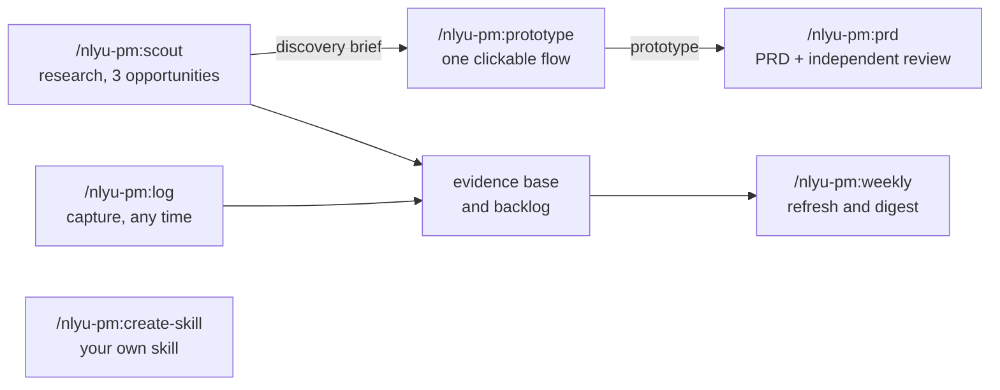

```text
╔═══════════════════════════════════════════════════════════════════════════════════╗
║                                                                                   ║
║   ███╗   ██╗ ██╗    ██╗   ██╗ ██╗   ██╗          ██████╗  ███╗   ███╗             ║
║   ████╗  ██║ ██║    ╚██╗ ██╔╝ ██║   ██║          ██╔══██╗ ████╗ ████║             ║
║   ██╔██╗ ██║ ██║     ╚████╔╝  ██║   ██║  █████╗  ██████╔╝ ██╔████╔██║             ║
║   ██║╚██╗██║ ██║      ╚██╔╝   ██║   ██║  ╚════╝  ██╔═══╝  ██║╚██╔╝██║             ║
║   ██║ ╚████║ ███████╗  ██║    ╚██████╔╝          ██║      ██║ ╚═╝ ██║             ║
║   ╚═╝  ╚═══╝ ╚══════╝  ╚═╝     ╚═════╝           ╚═╝      ╚═╝     ╚═╝             ║
║                                                                                   ║
║   Product discovery to PRD rapid cycle                                            ║
║   6 skills · 2 adversarial reviewer agents · 5 example cases or BYOR              ║
║   Claude desktop app (Code tab) · Claude Code CLI · OpenAI Codex                  ║
║                                                                                   ║
║   v0.11.0 · November 16, 2026 · MIT · Claude plugin directory: pending            ║
║                                                                                   ║
╚═══════════════════════════════════════════════════════════════════════════════════╝
```

Public evidence to a chosen opportunity, a clickable prototype, and an engineering-ready
PRD, grounded in the product's own code. No programming required.

# nlyu-pm: Rapid product discovery to PRD for Claude Code and Codex

A plugin for Claude Code and OpenAI Codex. It works on your own project or repository,
and five open-source example cases are included to try it on first. Your code is read
and never changed.

In the Claude desktop app:
**Settings**, **Plugins**, **Add**, **Add marketplace**, **Add from
a repo**, paste `https://github.com/niancilyu-2/nlyu-pm`, then install **nlyu-pm**.

In a terminal:

```text
/plugin marketplace add niancilyu-2/nlyu-pm
/plugin install nlyu-pm@nlyu-pm
```

In Codex (CLI, IDE extension, or app):

```text
codex plugin marketplace add niancilyu-2/nlyu-pm
```

then open `/plugins` and install **nlyu-pm**. In Codex the commands are `$scout`,
`$prototype`, `$prd`, `$log`, `$weekly`, and `$create-skill`, and prototypes are always a
standalone HTML file. The docs use the Claude Code names.

## Contents

- [Overview](#overview)
  - [Where it fits](#where-it-fits)
  - [What it does](#what-it-does)
  - [Agentic design principles](#agentic-design-principles)
- [Setup](#setup)
  - [Requirements](#requirements)
  - [Getting started](#getting-started)
- [Using it](#using-it)
  - [Your own project or repo (BYOP)](#your-own-project-or-repo-byop)
  - [Example cases to try it on](#example-cases-to-try-it-on)
  - [Guardrails and limits](#guardrails-and-limits)
- [Reference](#reference)
  - [Documentation](#documentation)
  - [Repository layout](#repository-layout)
  - [Licence and credits](#licence-and-credits)

## Overview

### Where it fits

The plugin covers the part of discovery that can be done from public evidence and a
product's own code, and the PRD that comes out of it.

```text
Vision
 ↓
Strategy
 ↓
Design
 └─ Discovery
     ├─ Customer insights          covered
     ├─ Competitor insights        covered
     ├─ Prototypes                 covered
     ├─ Experiments
     ├─ Feasibility validation     covered
     └─ Delivery PRD               covered
 ↓
Execution
```

- **Customer insights.** Forums, GitHub, app reviews, and release notes, with a bank of
  verbatim quotes and a check for counter-evidence.
- **Competitor insights.** Competitor pricing and feature pages now and a year ago, job
  postings, roadmaps, and adoption numbers.
- **Prototypes.** One clickable flow with two alternate states, a critique, and one
  revision.
- **Feasibility validation.** Constraints from the code with line references, and open
  questions for engineering.
- **Delivery PRD.** Requirements and acceptance criteria that trace back to the evidence.

Not covered: vision and strategy, experiments with real users, and execution. The
research is a scan of public sources, not customer validation, and the PRD is ready for
engineering review, not ready to build.

### What it does

Six skills. Each runs only when you type it.

| Skill | What it does | You leave with |
|---|---|---|
| [`/nlyu-pm:scout`](docs/skills/scout.md) | Researches public sources and the code, drafts three opportunities, has an independent reviewer check the evidence, and you choose one | A discovery brief |
| [`/nlyu-pm:prototype`](docs/skills/prototype.md) | Builds one clickable flow, critiques it with you, and revises it once | A prototype and its notes |
| [`/nlyu-pm:prd`](docs/skills/prd.md) | Writes a PRD grounded in the code, checked by an independent reviewer | A PRD and its review |
| [`/nlyu-pm:log`](docs/skills/log.md) | Files a call note, support thread, review, or link as evidence in about two minutes | An evidence base that grows |
| [`/nlyu-pm:weekly`](docs/skills/weekly.md) | Shows what changed this week and drafts a stakeholder update | A dated digest |
| [`/nlyu-pm:create-skill`](docs/skills/create-skill.md) | Turns one of your own PM practices into a reusable skill | Your own skill |

Scout, prototype, and PRD build on each other, but you can start at any of them. When an
earlier stage has not run, the skill asks for what it needs in a short intake and says so
in the file it writes. Log and weekly keep the evidence current between cycles.



Every reply ends with a status line such as `Scout · step 5/11 · fetches 6/20 · 14 min`,
so you always know where you are.

### Agentic design principles

- **Plan first.** `/nlyu-pm:scout` shows its source plan before fetching,
  `/nlyu-pm:prototype` confirms one flow before building, and `/nlyu-pm:prd` agrees scope
  before drafting.
- **You decide.** Ranking, flow, scope, and review findings are settled at check-ins that
  show Claude's recommendation and your decision separately.
- **Adversarial review.** `/nlyu-pm:scout` and `/nlyu-pm:prd` hand their drafts to a
  read-only reviewer that has not seen the conversation. Blocking findings must be fixed.
- **Evidence over confidence.** Every claim is labelled, every fetch is saved, every quote
  is checked against its source, and gaps are logged instead of filled.
- **Least privilege.** Your code is read-only. Writes go to `outputs/` and `.pm/`.
- **Untrusted input stays data.** Text in web pages and repositories is evidence, never
  instructions.
- **State in files.** Decisions and drafts live in files, so a new session loses nothing.
- **Budgets.** Research runs on a fixed fetch budget, and every reply shows what has been
  spent.
- **One job per skill.** Each skill does one thing and runs only when typed.

## Setup

### Requirements

- Claude (the desktop app's Code tab, or Claude Code in a terminal) on a Pro, Max, Team,
  or Enterprise plan, or OpenAI Codex.
- Git.
- Web access for research.

New to this? [docs/SETUP.md](docs/SETUP.md) walks through the install step by step.

### Getting started

1. Open your repository's top folder, or an empty folder, in Claude or Codex.
2. Run `/nlyu-pm:scout`. It checks your setup, then asks which product: your own (BYOP,
   bring your own project or repo) or an example case.
3. Run scout, prototype, and PRD in order, each in a new session in the same folder.
4. After that, use `/nlyu-pm:log` whenever you hear something worth keeping and
   `/nlyu-pm:weekly` about once a week. For a small change, go straight to
   `/nlyu-pm:prototype` or `/nlyu-pm:prd`.

[docs/TEST-WALKTHROUGH.md](docs/TEST-WALKTHROUGH.md) shows each stage and what to expect.

## Using it

### Your own project or repo (BYOP)

This is the normal path. Read access is all you need, and nothing is written into your
repository.

- **Inside a local copy.** Open the top folder of your clone and run `/nlyu-pm:scout`.
- **From an empty folder.** Choose BYOP and give a repository URL, a folder on your
  computer, or a zip. Private repositories work if your computer already has access.
  Claude never asks for a password or token.

Claude then builds a product package in about fifteen minutes. It asks which sources to
read, reads the README and folder structure, and asks you three things: the user you
design for, your brief, and the focus area. You confirm the package before research
starts.

A product with an active issue tracker or forum gets a full research pass. A private or
new product has less public evidence, so its brief is marked provisional and says who was
not heard from. A source behind a sign-in you hold can be added through access you set up
yourself.

### Example cases to try it on

To see the workflow first, choose an example case when `/nlyu-pm:scout` asks. Five
open-source products come prepared. You act as the product's PM, designing for one of its
users, and pick one focus area to work in.

| Product | What it is | Who you design for |
|---|---|---|
| **Immich** | Self-hosted photo and video backup for a household | The person who runs the server for the family |
| **Plane** | Open-source project and work tracking, like Jira or Linear | A product-operations lead |
| **Home Assistant** | Local smart-home control with dashboards and automations | A nontechnical household co-admin |
| **Umbraco** | A content management system for websites | A regional content editor |
| **ERPNext** (advanced) | Business management for stock, purchasing, and accounting | An inventory or procurement manager |

Each case has three focus areas, listed in
[docs/TEST-WALKTHROUGH.md](docs/TEST-WALKTHROUGH.md). Only the folders a focus area needs
are downloaded. ERPNext is larger and downloads two repositories.

### Guardrails and limits

- Public information and made-up data by default. No password, token, or key ever enters
  the conversation.
- Notes from inside your company are accepted only in `/nlyu-pm:log`, as an excerpt you
  choose to paste. They stay on your computer with personal details removed.
- Every claim is labelled `Evidence`, `Inference`, `Assumption`, or `Constraint`.
- No scores, estimates, story points, delivery dates, or costs.
- The research is a public scan, not customer validation. The prototype walkthrough is a
  critique, not user testing.
- Claude writes only under `outputs/` and `.pm/`, plus your skills folder for the skill
  builder and `sources/` for example-case downloads.

## Reference

### Documentation

| Doc | For |
|---|---|
| [docs/skills/](docs/skills/) | One page per skill |
| [docs/SETUP.md](docs/SETUP.md) | Install steps for the Claude desktop app, Claude Code in a terminal, and Codex |
| [docs/TEST-WALKTHROUGH.md](docs/TEST-WALKTHROUGH.md) | Every stage and every example case, step by step |

### Repository layout

```text
nlyu-pm/
├── .claude-plugin/marketplace.json      Claude Code marketplace
├── .agents/plugins/marketplace.json     Codex marketplace
├── plugins/nlyu-pm/
│   ├── .claude-plugin/plugin.json       Claude Code manifest
│   ├── plugin.json                      Codex manifest
│   ├── skills/                          scout, prototype, prd, log, weekly, create-skill
│   ├── agents/                          the two read-only reviewers
│   ├── cases/                           the five example cases
│   └── resources/                       shared rules, guides, and templates
├── docs/
├── CHANGELOG.md
└── README.md
```

When you publish a changed build, bump `version` in both `plugin.json` files and in
`.claude-plugin/marketplace.json`, and update the banner above. To develop locally:

```bash
claude plugin validate . --strict
claude plugin validate ./plugins/nlyu-pm --strict
claude --plugin-dir ./plugins/nlyu-pm
```

### Licence and credits

MIT licensed. The five example products keep their own licences (Immich and Plane
AGPL-3.0, Home Assistant Apache-2.0, Umbraco MIT, ERPNext GPL-3.0, Frappe MIT), and
nothing from them is redistributed here.

- Dean Peters' [PM Skill Creator](https://github.com/deanpeters/Product-Manager-Skills)
  (CC BY-NC-SA 4.0) inspired the conversational skill builder and the one-job rule. The
  skill builder here is written independently.
- The [product-on-purpose](https://github.com/product-on-purpose) repositories
  (Apache-2.0) informed the organisation of this README.
