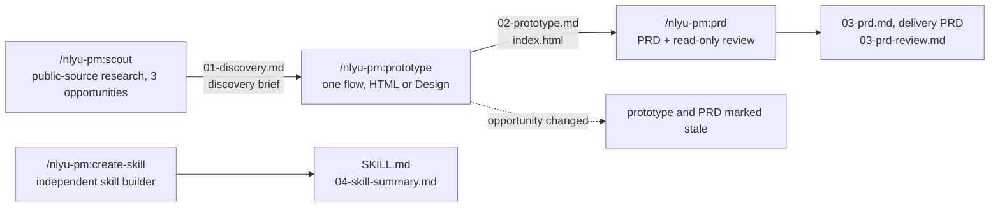

```text
╔═══════════════════════════════════════════════════════════════════════════════════╗
║                                                                                   ║
║   ███╗   ██╗ ██╗    ██╗   ██╗ ██╗   ██╗          ██████╗  ███╗   ███╗             ║
║   ████╗  ██║ ██║    ╚██╗ ██╔╝ ██║   ██║          ██╔══██╗ ████╗ ████║             ║
║   ██╔██╗ ██║ ██║     ╚████╔╝  ██║   ██║  █████╗  ██████╔╝ ██╔████╔██║             ║
║   ██║╚██╗██║ ██║      ╚██╔╝   ██║   ██║  ╚════╝  ██╔═══╝  ██║╚██╔╝██║             ║
║   ██║ ╚████║ ███████╗  ██║    ╚██████╔╝          ██║      ██║ ╚═╝ ██║             ║
║   ╚═╝  ╚═══╝ ╚══════╝  ╚═╝     ╚═════╝           ╚═╝      ╚═╝     ╚═╝             ║
║                                                                                   ║
║   Product discovery to PRD rapid cycle                                            ║
║   4 skills · 1 adversarial reviewer agent · 5 example cases or BYOR               ║
║   Claude desktop app (Code tab) · Claude Code CLI                                 ║
║                                                                                   ║
║   v0.8.3 · October 31, 2026 · MIT · Claude plugin directory: pending              ║
║                                                                                   ║
╚═══════════════════════════════════════════════════════════════════════════════════╝
```

Public evidence to a chosen opportunity, a clickable prototype, and an engineering-ready
PRD, grounded in the product's own code. No programming required.

# nlyu-pm: Rapid product discovery to PRD for Claude Code

A Claude Code plugin that takes a product manager from public evidence to a selected
opportunity, a clickable prototype, and an engineering-ready PRD, on your own project or
repository. Five open-source example cases are included to try it on first. Claude finds, drafts,
and challenges. The PM decides, and every stage records which was which.

No programming required. The product's source code is read and never changed. One PM
can run it alone, or a team can run it together.

In the Claude desktop app: **Settings**, **Plugins**, **Add**, **Add marketplace**, **Add from
a repo**, paste `https://github.com/niancilyu-2/nlyu-pm`, then install **nlyu-pm**. In a
terminal:

```text
/plugin marketplace add niancilyu-2/nlyu-pm
/plugin install nlyu-pm@nlyu-pm
```

## Contents

- [Overview](#overview)
  - [Where it fits](#where-it-fits)
  - [What it does](#what-it-does)
  - [Agentic design principles](#agentic-design-principles)
- [Setup](#setup)
  - [Requirements](#requirements)
  - [Getting started](#getting-started)
- [Using it](#using-it)
  - [Your own project or repo (BYOP)](#your-own-project-or-repo-byop)
  - [Example cases to try it on](#example-cases-to-try-it-on)
  - [Guardrails and limits](#guardrails-and-limits)
- [Reference](#reference)
  - [Documentation](#documentation)
  - [Repository layout](#repository-layout)
  - [Licence and credits](#licence-and-credits)

## Overview

### Where it fits

A typical product lifecycle runs from vision and strategy through design to execution.
This plugin covers the discovery part of design that can be done from public evidence and
a product's own code, and the delivery PRD that comes out of it. Items marked covered are
the steps it performs.

```text
Vision
 ↓
Strategy
 ↓
Design
 └─ Discovery
     ├─ Customer insights          covered
     ├─ Competitor insights        covered
     ├─ Prototypes                 covered
     ├─ Experiments
     ├─ Feasibility validation     covered
     └─ Delivery PRD               covered
 ↓
Execution
```

What each covered step contains:

- **Customer insights.** Forum, GitHub, and community posts; app reviews and release notes;
  any public source you add and any you drop; a verbatim quote bank; triangulation and a
  counter-evidence pass; a note on who the sources hear from and who is missing.
- **Competitor insights.** Competitor pricing and feature pages today and a year ago,
  competitors' job postings, the product's own roadmap, and adoption numbers.
- **Prototypes.** A clickable prototype of the chosen flow with two alternate states, a
  design critique, and one revision.
- **Feasibility validation.** Repository constraints with line references, likely code
  touchpoints, a read-only engineering review, and open questions for engineering.
- **Delivery PRD.** Requirements and acceptance criteria with IDs, states and behaviour, an
  engineering appendix, all traceable to the evidence.

Outside its scope: vision and strategy, experiments with real users (A/B tests, fake doors,
pilots), and execution. The customer insights come from public sources rather than
interviews or surveys, so they are a scan, not customer validation, and the PRD is marked
ready for engineering review, not ready to build.

### What it does


Four skills. Each runs only when you type it.

| Skill | What it does | You leave with | Details |
|---|---|---|---|
| `/nlyu-pm:scout` | Readiness check on first run, a case built from your own repository (or an example case to try it on), then a research pass over a fixed sequence of public sources, repository constraints, three opportunities, and your choice of one | `outputs/01-discovery.md`, the discovery brief | [docs/skills/scout.md](docs/skills/scout.md) |
| `/nlyu-pm:prototype` | One actor, one job, one flow. A clickable prototype in Claude Design or as a standalone HTML file, a design critique, one revision | `outputs/02-prototype.md`, `outputs/prototype/index.html` | [docs/skills/prototype.md](docs/skills/prototype.md) |
| `/nlyu-pm:prd` | A delivery PRD grounded in the product's code, reviewed by a separate read-only agent that has not seen your conversation | `outputs/03-prd.md`, `outputs/03-prd-review.md` | [docs/skills/prd.md](docs/skills/prd.md) |
| `/nlyu-pm:create-skill` | Turn one PM practice of your own into a small project skill, test it once in a fresh session, revise it once | `.claude/skills/<name>/SKILL.md`, `outputs/04-skill-summary.md` | [docs/skills/create-skill.md](docs/skills/create-skill.md) |

Each skill opens by saying what you will do, what Claude will do, and what you
decide, and ends every reply with a status line such as
`Scout · step 5/10 · fetches 6/20 · 14 min`. Each stage closes with one summary line of
what the run spent and produced, for example
`Discovery complete · 58 min · fetches 17/20 · searches 3/8 · items 24 · quotes 8 · gaps 1 · approved`,
repeated in the output file's header.



### Agentic design principles

A few rules govern how Claude and the PM share the work, each enforced in the skill files
rather than left to good intentions.

- **Plan first** `/nlyu-pm:scout` shows its source plan before the first fetch,
  `/nlyu-pm:prototype` confirms one actor, one job, and one flow before building, and `/nlyu-pm:prd`
  agrees scope before drafting.
- **Human in the loop at every judgement.** Ranking the opportunities, approving the flow,
  setting PRD scope, and dispositioning review findings happen at check-ins that show
  *Claude's recommendation* and *Your decision* as separate blocks.
- **Adversarial review.** `/nlyu-pm:prd` hands the draft to a read-only reviewer agent that has
  not seen the conversation; it reopens every `Verified` code path, and blocking findings
  must be fixed, not deferred.
- **Evidence over confidence.** Every claim is labelled `Evidence`, `Inference`,
  `Assumption`, or `Constraint`; `/nlyu-pm:scout` runs a counter-evidence fetch per theme, logs
  gaps instead of inventing sources, and saves a provisional file when cut short.
- **Least privilege.** Source repositories are read-only and baseline-checked at the start
  and end of each stage; writes go only under `outputs/`, `.pm/`, `.claude/skills/`, and,
  for example cases, the `sources/` download.
- **Untrusted input stays data.** Text in web pages and repositories is evidence, not
  instructions; a product's own `CLAUDE.md` counts as developer documentation.
- **State in files, not in context.** Decisions append to `.pm/session.yaml` and drafts
  are promoted on approval, so `/clear` between stages loses nothing and an upstream change
  marks later stages stale.
- **Budgets and observability.** `/nlyu-pm:scout` runs on a fixed fetch budget with a
  coverage-based stop rule, and every reply ends with a status line of step, fetches,
  minutes, and source status.
- **One job per skill, tested in isolation.** Each skill runs only when typed; the skill
  written in `/nlyu-pm:create-skill` is tested in a fresh session before its one revision.

## Setup

### Requirements


- The Claude desktop app's Code tab, or Claude Code in a terminal, on Windows or macOS,
  with a Claude Pro, Max, Team, or Enterprise account (the free plan does not include
  Claude Code).
- Git.
- Web fetch enabled. Web search and Claude Design are optional; both have fallbacks.

New to this? [docs/SETUP.md](docs/SETUP.md) walks through the install step by step, with
one section for the desktop app (about 15 minutes, no terminal) and one for the terminal.

### Getting started


1. Open the top folder of a local copy of your repository, or a new empty folder if you
   will give a URL or a zip instead (or want to try an example case), in the desktop
   app's Code tab or in a terminal running `claude`.
2. Install the plugin as above and run `/nlyu-pm:scout`.
3. The readiness check ends with `Ready`, `Ready with fallback`, or `Blocked` with one
   next action. `/nlyu-pm:scout` then asks which product: your own (BYOP, bring your own
   project or repo) or one of the example cases. You can also decide later; either way,
   `/nlyu-pm:scout` resumes.
4. Run the stages in order, one session each: start a new session in the same folder
   between them (`/clear` in a terminal); each resumes from the files you approved.

[docs/TEST-WALKTHROUGH.md](docs/TEST-WALKTHROUGH.md) shows every stage step by step with
what to expect at each check-in.

## Using it

### Your own project or repo (BYOP)

This is the normal path. The three stages run on any repository. Read access is all you need; no mode
writes into the repository. Ways in:

- **Start inside a local copy.** Open the top folder of a clone you already have in the
  Code tab or in a terminal running `claude`, then run `/nlyu-pm:scout`. Claude treats that repository as the product,
  never edits a tracked file, and writes only `outputs/` and `.pm/` (offering to hide them
  from `git status`).
- **Start in an empty folder and point at it.** Choose *BYOP* at the first question
  `/nlyu-pm:scout` asks, then give one of: a repository URL (public, or private if your computer
  already has read access through SSH, a saved credential, or a signed-in `gh`); a folder
  on your computer; or a zip of the repository, from the hosting site's *Download ZIP*
  button or from an engineer. Claude never asks for a password or token; if a private
  clone needs one, it asks you to run the clone line yourself so the prompt reaches you.
  A zip without git history works too; the brief then says the snapshot is unpinned.

Claude then builds the case package in about fifteen minutes. It asks three source
questions first: which built-in source groups to use, shown as a plain-words menu;
anything extra to read (a public page or feed, a document you drop in `.pm/inbox/`, a page
you will paste from); and whether any source behind a sign-in you hold should be
included. Then it reads the README, folder tree, and dependency manifest, asks you three
questions (the user you design for, your brief on their behalf, the focus area), proposes
the code entry points for that area, derives the public research sources from the
repository's footprint (issues, discussions, forum, app stores, adoption numbers,
competitors you name), and writes the orientation and design notes it will rely on
later. You confirm the package at a check-in before any research starts. From there the
output is the same discovery brief, prototype, and PRD, with every technical claim
labelled by what Claude actually opened.

What differs from an example case is honesty about coverage, not the process. A product
with a busy issue tracker and a forum gets a full research pass. A private or new product
gets repository constraints, competitor comparison, and whatever public material you can
paste in; its brief is marked provisional and says which voices are missing. Claude never
asks for support tickets, analytics, or customer records. A source behind a subscription
or sign-in you hold (a paid report, a members-only forum, your private issue tracker) can
be included through access you set up yourself; Claude never asks for or sees the secret,
and the brief marks what came from it.

Anyone can also prepare a case package by hand for a product a team will work on; see
`plugins/nlyu-pm/resources/case-schema.md`.

### Example cases to try it on

To see the workflow before pointing it at your own code, choose an example case when
`/nlyu-pm:scout` asks which product. Five open-source products come prepared, each with
verified research sources, a fixed code snapshot from a set date, and only the folders
the focus areas need, tens of megabytes rather than hundreds. You work on the product as
its PM, designing for one of the users it serves, and pick one focus area within it. The
tool calls a product package a case and a focus area a lane: a part of the product you
research for an hour, choose one opportunity in, and prototype as a single flow. Claude
explains this again before asking you to pick.

| Product | What it is | Example user you design for | Example use case | Size and language at the pinned commit |
|---|---|---|---|---|
| **Immich** | Self-hosted photo and video backup for a household, with a phone app and a web app | Household media steward: the one person who runs the server for the family | A parent wants to see from their phone that last weekend's photos are safely backed up before deleting them | ~320 KLOC: TypeScript, Dart, Svelte |
| **Plane** | Open-source project and work tracking, in the spirit of Jira or Linear | Product-operations lead | Requests arrive by chat and email; the lead triages them into one intake queue and schedules them into cycles | ~390 KLOC: TypeScript, Python |
| **Home Assistant** | Local smart-home control with dashboards, device repair, and automations | Nontechnical household co-admin | After an update a sensor stops responding; the co-admin restores a backup or repairs the device without touching configuration files | Frontend ~600 KLOC TypeScript (the code you read); core ~3,700 KLOC Python (web reference only) |
| **Umbraco** | A content management system's editing backoffice for websites | Regional content-operations editor | An editor drafts a campaign page in two languages, reuses images from the library, and publishes without asking a developer | ~1,300 KLOC: C#, TypeScript |
| **ERPNext** (advanced) | Business management for stock, purchasing, and accounting, built on the Frappe framework | Inventory or procurement operations manager | Stock counts disagree with the system; the manager resolves the exception and approves an urgent purchase order with the audit trail intact | ~530 KLOC Python and JavaScript, plus Frappe ~500 KLOC |

Sizes are source lines at the pinned commits, tests included, generated code and
translations excluded, rounded. Only the folders the focus areas need are downloaded.
Each case has three focus areas; Claude shows them, with what a focus area is, when you
pick a case, and [docs/TEST-WALKTHROUGH.md](docs/TEST-WALKTHROUGH.md) lists them all.

ERPNext is the advanced option: it downloads the product and the Frappe framework it runs
on. Pick a case and a focus area, and research starts at once; the output is the same
brief, prototype, and PRD as for your own repository. The product packages hold
boundaries and starting points only, never conclusions, so the research is yours.

### Guardrails and limits


- Public information and synthetic data by default. No private customer data or
  confidential material, and no password, token, or key ever enters the conversation; your
  own repository and any source behind a sign-in are read only through access you already
  hold and set up yourself. Your own repository is read in place and never modified.
- Every claim is labelled `Evidence`, `Inference`, `Assumption`, or `Constraint`. Technical
  statements in the PRD are `Verified` with a file path, `Inferred`, or `Engineering-owned`.
- No composite scores, RICE, ARR, PERT, estimates, story points, delivery dates, or costs.
- The research pass is a quick public scan, not customer validation. The prototype
  walkthrough is a design critique, not user testing. You can add or drop sources,
  including ones behind a sign-in you hold, but Claude never bypasses a CAPTCHA or
  paywall, scrapes page by page, or handles a secret.
- Text found in websites and repositories is evidence, not instructions.
- Claude writes only under `outputs/`, `.pm/`, for the skill builder `.claude/skills/`, and
  for example cases the downloaded repositories in `sources/`, whether the workspace is an
  empty folder or your own repository.
- Prototypes are exercise artifacts, not for distribution. No source files are copied out
  of the downloaded repositories.

## Reference

### Documentation


| Doc | For |
|---|---|
| [docs/skills/](docs/skills/) | One page per skill: what it produces, how a run goes, the rules it follows |
| [docs/SETUP.md](docs/SETUP.md) | Setup, with a section for the Claude desktop app (no terminal) and one for Claude Code in a terminal |
| [docs/TEST-WALKTHROUGH.md](docs/TEST-WALKTHROUGH.md) | Every stage and every product, step by step |

### Repository layout


```text
nlyu-pm/
├── .claude-plugin/marketplace.json
├── plugins/nlyu-pm/
│   ├── .claude-plugin/plugin.json
│   ├── skills/{scout,prototype,prd,create-skill}/SKILL.md
│   ├── agents/prd-reviewer.md
│   ├── README.md                what the plugin runs, reads, fetches, and writes
│   ├── LICENSE
│   ├── cases/{immich,plane,home-assistant,umbraco,erpnext}/
│   │   ├── case.yaml            fixed commit, focus areas, source URLs
│   │   ├── orientation.md
│   │   └── design-notes.md
│   └── resources/               shared rules, research guide, readiness, case schema,
│                                BYOP case builder, templates
├── docs/
├── CHANGELOG.md
├── LICENSE
└── README.md
```

Everything a skill needs at runtime lives under `plugins/nlyu-pm`. When you publish a changed
build, bump `version` in both `plugins/nlyu-pm/.claude-plugin/plugin.json` and
`.claude-plugin/marketplace.json`, otherwise existing installs will not refresh, and
update the version line in the banner at the top of this README. To
develop locally:

```bash
claude plugin validate . --strict
claude plugin validate ./plugins/nlyu-pm --strict
claude --plugin-dir ./plugins/nlyu-pm
```

### Licence and credits


Original content is MIT licensed. The five example products' repositories keep their own
licences: Immich and Plane AGPL-3.0, Home Assistant Apache-2.0, Umbraco MIT, ERPNext
GPL-3.0, Frappe MIT. Nothing from them is redistributed here, and nothing from your own
repository is copied into the outputs.

- Dean Peters' [PM Skill Creator](https://github.com/deanpeters/Product-Manager-Skills)
  (CC BY-NC-SA 4.0) was conceptual inspiration for conversational skill authoring and the
  one-job rule. The skill builder is written independently and shares no wording, metadata,
  scripts, or structure with it.
- The [product-on-purpose](https://github.com/product-on-purpose) repositories
  (Apache-2.0) informed the organisation of this README.
